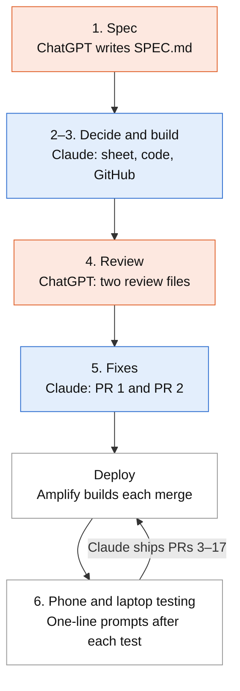

# Halloween Trick-or-Treat Map: how it was built with ChatGPT and Claude

*Written 1 Nov 2026.*

## Overview

The site went from a ChatGPT-written spec to a live AWS app in about 8 hours of active work, spread over short sessions on three days (28–30 Oct 2026). Claude wrote all of the code; ChatGPT wrote the spec and reviewed Claude's work twice. Every step was steered with short prompts, and the site was tested on a phone and a laptop.

**Who did what** (blue: Claude, orange: ChatGPT, grey: testing and AWS):



ChatGPT wrote and reviewed; Claude built and fixed; files were carried between them by hand.

**What it is:** a one-night map for neighbours around Michalis Tourapis Park, Nicosia. Homes taking part in trick-or-treat on 31 Oct mark themselves on the map. The link and a group code are shared in the neighbourhood Viber group.

**Stack:** AWS Amplify Gen 2 (AppSync GraphQL with JavaScript resolvers, DynamoDB), React + Vite, Google Maps with an Esri fallback. Code in this repository, deployed by Amplify on every push to `main`.

| Step | When | Who | What happened |
| --- | --- | --- | --- |
| 1. Spec | before 28 Oct | ChatGPT | Wrote `SPEC.md`: Cognito sign-in (email, SMS, passkeys), 2 km map, DynamoDB model |
| 2. Decisions | 28 Oct morning | Claude | Claude critiqued the spec; 21 decisions settled in a spreadsheet with drop-downs |
| 3. Build | 28 Oct | Claude | Built the app as a zip, pushed to GitHub; group code moved out of the repo |
| 4. Review | 29 Oct | ChatGPT | Reviewed the repo and wrote the issues into `CLAUDE_REVIEW_CONCERNS.md` |
| 5. Fixes | 29 Oct | Claude | Fixed the issues (PR #1), then a follow-up review (`CLAUDE_FINAL_FOLLOWUP.md`) led to PR #2 |
| 6. Testing changes | 30 Oct | Claude | 15 PRs from testing: Google Maps, admin code, simpler form, print/PDF, street number |

**What made it work:**

- **A second model as reviewer.** ChatGPT's review found two real bugs (a blank map from the referrer header; a race that could break the map for everyone) that Claude's own tests had missed.
- **Claude reproduced before fixing.** Each fix came with a test that failed on the old code and passed on the new, and each "no issue" verdict pointed to the code and tests behind it.
- **Short prompts after real use.** Most of day 3 was one-line requests made right after trying the site on a phone or laptop.
- **Honest gaps.** Anything Claude could not run (AWS, real tiles, Viber on a phone) was marked BLOCKED and handed back as a checklist or a script.

### Time spent

About 8 hours of active work built the site, estimated from the chat timestamps. A session runs from its first prompt to Claude's last delivery (a zip, a merge or an answer), and a gap of more than 30 minutes between messages starts a new one. Work done between messages, such as setting up Amplify or testing, counts only when it fell inside a session, so the real total may be a little higher.

| Day | Sessions | Active time |
| --- | --- | --- |
| Wed 28 Oct | 1 h 36 min decisions and build; 1 h 14 min GitHub and fixes | about 2 h 50 min |
| Thu 29 Oct | 24 min first ChatGPT review; 5 min and 35 min PR #1 and PR #2 | about 1 h 5 min |
| Fri 30 Oct | 7 min and 13 min Amplify setup; 8 min, 28 min, 2 h 48 min and 20 min testing changes | about 4 h 5 min |
| **Total** |  | **about 8 h** |

## Step 1: the spec (ChatGPT)

ChatGPT wrote `SPEC.md` ("Technical Requirements & Implementation Specification v1.0, 28 October 2026"), 11 sections long. It was precise but sized for a multi-week build, not one due in a few days.

| SPEC.md section | What it asked for |
| --- | --- |
| 1. Scope and architecture | Amplify Gen 2, Cognito, AppSync, DynamoDB, React + Leaflet + OpenStreetMap; dev and production environments |
| 2. Identity | Exactly three sign-in methods: email one-time code, SMS one-time code, passkeys; account linking between email and phone |
| 3. Authorization | Server-side ownership by Cognito `sub`; visitors read only |
| 4. Data model | `Location` and `Contribution` tables; a 2 km × 2 km box around Michalis Tourapis Park |
| 5–9 | Map and UX, shared buildings, API, hosting, encryption, security and privacy |
| 10–11 | Acceptance criteria; decisions needing confirmation |

**First prompt to Claude** (28 Oct), with `SPEC.md` attached, in short:

> I want a website where neighbours mark their homes on a map for trick-or-treat on Saturday 31 Oct, with the parents' names on each marker. Here is my draft spec. What do you think?

**Claude's answer, in short:** the spec is careful, but the timeline is the problem. SMS and email codes need AWS reviews (SMS sandbox, SES production access) that may not finish by Saturday. Passkeys and account linking alone could take the three days. Claude proposed a lean v1 and listed what the spec was missing: parents' names, GDPR (hide after the event, `noindex`, consent), a door-code warning, event-night features and moderation.

## Step 2: deciding what to build

In about an hour of chat on 28 Oct the design moved from Cognito accounts to no accounts at all: a shared group code plus a personal edit code per home. Claude first listed 21 decisions as chat questions; a spreadsheet was asked for instead, which went through three versions.

| Elapsed | Prompt (summary) | Result |
| --- | --- | --- |
| 0 | I have full AWS admin access. Ask me about each point one by one. How do I get the code into Amplify? Can you connect to my AWS account directly? | 21 numbered questions with a recommendation each. Delivery explained: a code repository pushed to GitHub and connected to Amplify; no keys shared in chat |
| +11 min | Do I unzip it into git and give Amplify the link? | Step-by-step: unzip, push to a new GitHub repo, connect it in Amplify |
| +12 min | 21 questions are hard to answer in chat. Make a spreadsheet with a drop-down for each. | `halloween-map-decisions.xlsx`: 27 rows, a drop-down per row, pre-filled with Claude's recommendation |
| +16 min | The link will be shared in a neighbourhood Viber group. Does that change anything? | Claude suggested two posts (hosts on Thursday, parents on Saturday) |
| +22 min | Can the sign-in codes go by Viber instead of SMS? | Viber can't send codes to a phone number; suggested a private edit link shared to Viber instead |
| +39 min | One link for everyone, plus a shared code in the Viber group so it isn't fully public. After adding a home, show a personal code for editing it later. As admin I want to see all codes and edit any entry. | The final model: group code checked by the server, edit codes like `BAT-CANDY-17`. Sheet v2 (29 rows) |
| +43 min | Drop email and the admin account. I'll look up codes in DynamoDB. | No email, no admin login; codes read in the DynamoDB console. Sheet v3 (25 rows) |
| +47 min | Why do we need spam protection? | Explanation of the repeated-wrong-code limit |
| +56 min | (filled spreadsheet attached) | Build starts |

**Main decisions in sheet v3:** no accounts; group code to see details; edit code per home; entries only (homes within about 15 m grouped into one pin); first names, optional; apartment, bell and 200-character notes fields; English and Greek; map hides at 1 Nov 02:00 and data is deleted after 7 days; production only.

## Step 3: implementation and GitHub (Claude)

Claude built the whole project in about 30 minutes after the sheet came back and handed it over as `halloween-map.zip` (28 Oct). It was pushed to GitHub that morning; two problems found in the first hour were fixed the same day.

**What Claude built and checked before handing over:**

- Amplify Gen 2 backend: one DynamoDB table with automatic deletion, 5 AppSync operations written as JavaScript resolvers, a public API key. All rules (group code, edit code, 5-tries lockout, map area, closing time) are checked on the server.
- React + Leaflet front end in English and Greek, with an edit-code screen that can copy the code or send it to Viber.
- 11 automated tests running the real resolver code against a simulated DynamoDB table; an offline compile of the AWS definition; a click-through in a phone-sized browser, which found and fixed one bug (the map broke while placing a pin).
- Not tested: a real AWS deploy and real map tiles, since Claude had no access to either.

**Getting it into GitHub (28 Oct):**

| Elapsed | Prompt (summary) | Result |
| --- | --- | --- |
| 0 (new session) | `git commit` fails asking who I am. | `git config user.name / user.email` |
| +8 min | Where do I set a GitHub token? | Where to create a GitHub personal access token |
| +15 min | `git push` fails with 403. | The push worked on the next try, 2 minutes later (`614fc78`) |
| +18 min | What is the repo URL? | Repo URL |
| +19 min | You put the group code in the README! | Claude owned the mistake; options: make the repo private, remove the code from the README, change the code |
| +21 min | I removed it from the README. Is it also hardcoded in the code? | Yes, in `amplify/settings.ts`; Claude offered to move it to an Amplify environment variable |
| +22 min | Yes, use an Amplify environment variable. | `GROUP_CODE` read from Amplify at build time; the build stops if it is missing (`4996098`) |
| +59 min | Can you check that the repo is OK? | Claude cloned the repo and found the build would fail: the lock file was out of step with some packages |
| +1 h 8 min | Done. Check again. | Build switched to `npm install` (`d8780e0`) |

`31OCT` stays in the public git history, so it must never be used as the real group code.

## Step 4: ChatGPT reviews Claude's work

To let ChatGPT review the build, Claude was first asked for a summary of everything that had changed since `SPEC.md`. ChatGPT then wrote its concerns into `CLAUDE_REVIEW_CONCERNS.md`, a list ranked P0 to P2 (P0-1, P0-2, P1-3 … P2-9), which was attached in the Claude chat.

| Elapsed (29 Oct) | Prompt (summary) | Result |
| --- | --- | --- |
| 0 | Write a document for ChatGPT on the design decisions made since `SPEC.md`. | A design-decisions doc: what changed from the spec and why |
| +2 min | What type of document is this? | Explained the doc format |
| +11 min | `CLAUDE_REVIEW_CONCERNS.md` attached (written by ChatGPT) | Claude audited the GitHub code line by line against each item |

**What the audit found** (Claude's reply: `CLAUDE_REVIEW_RESPONSE.md` and `audit-fixes.zip`, +21 min):

| # | Severity | Finding | Outcome |
| --- | --- | --- | --- |
| A | P0 | `Referrer-Policy: no-referrer` breaks OpenStreetMap's tile policy: the live map could be blank | Bug, fixed (`strict-origin-when-cross-origin`) |
| B | P0 | A wrong-code attempt at the moment an owner deleted their home could leave a broken record that stops the map loading for everyone | Bug, fixed |
| C | P1 | Home ids were visible without the group code; a script had about a 42% chance of taking over one of 50 homes before the event | Fixed: ids hidden, each repeated lockout doubles the wait; about 2% |
| D | P1 | Someone with the group code can lock a neighbour out for hours | Accepted; unlock by hand in DynamoDB |
| E | P1 | Edit codes used `Math.random()` | Fixed: secure randomness |
| F | P1 | "Remove my home" used a browser pop-up that Viber may block | Fixed: an in-page Yes / Cancel panel |
| G, H | P1 | No limit on creating entries; list stops at about 1,000 rows | Accepted; spam runbook instead |
| I–N | P1–P2 | Code checks, data exposure, plaintext codes, grouping, times, build secrets | No issue |
| O, P | P2 | Needs a live check; `31OCT` in git history | Checklist; never reuse `31OCT` |

Each fix came with a test: 6 new tests that fail on the old code and pass on the new (17 in total). Nothing had yet run on real AWS or a real phone.

## Step 5: Claude fixes the review findings

On the evening of 29 Oct GitHub was connected to the Claude session, so Claude could push branches and open pull requests itself instead of sending zips. Both review rounds were merged in under an hour.

| Elapsed (29 Oct) | Prompt (summary) | Result |
| --- | --- | --- |
| 0 (new session) | How do I apply the zip? Can you make the git changes yourself? | The unzip/commit/push commands, plus how to connect GitHub to the session |
| 0 (new session) | GitHub is connected. Push the changes. | PR #1 "Audit fixes: OSM referrer, attempt race, lockout escalation, secure codes, in-page confirm" |
| +2 min | Merge it. | PR #1 merged (`19b8f2c`) |
| +15 min | `CLAUDE_FINAL_FOLLOWUP.md` attached (ChatGPT's second review) | `CLAUDE_FINAL_REPORT.md`: every check marked PASS, FAIL or BLOCKED. No new code defects; the README lacked an operations runbook. PR #2 adds it plus `scripts/smoke_test.py`, a one-command check of the live site |
| +32 min | Merge it. | PR #2 merged (`a9a123c`) |

**What stayed open after step 5:** everything that needed the real AWS account or a phone. Claude marked these BLOCKED rather than passed, and the smoke test turned them into one command to run.

## Step 6: changes from testing (30 Oct)

Once the site was live on Amplify, it was tested on a phone and a laptop, and changes were asked for in one-line prompts. Claude shipped 15 pull requests (#3–#17) across the day, in under 4 hours of sessions, each tested, merged and deployed automatically.

**Deploying to Amplify:** a few questions on the Amplify setup (the steps, why to leave "monorepo" unticked, a commit missing from the list). After this the site was live at `main.d16pkk6i6bwic1.amplifyapp.com`.

| Elapsed | Prompt (summary) | What Claude changed | PR |
| --- | --- | --- | --- |
| 0 (session 1) | The map is poor; you can't see the houses. | Opens on satellite imagery, with a Map / Satellite switch | #3 |
| +5 min | Do I need to do anything to deploy this? | Nothing: every merge to `main` redeploys | — |
| 0 (session 2) | The street map has no road names. Use something else. | Esri street map with street names | #4 |
| +15 min | I don't like the maps. Use Google Maps. Also, the area looks too big. | Google Maps (Esri as fallback); area cut from 2 km × 2 km to 1.5 km × 1.5 km | #5 |
| 0 (session 3) | Add an admin code to edit any entry from the site, and let owners or the admin delete entries. | Admin code (`SUPER_CODE` in Amplify) that edits or removes any home from the site | #6 |
| +12 min | Admin code minimum 10 characters, not 12. | Minimum length 10 | #7 |
| +29 min | Location doesn't work on my phone. Add help for turning it on. | A help panel with the exact steps for the visitor's phone and browser, and a Try again button | #8 |
| +44 min | Too many form fields. Remove the bell field; ask house or apartment, and ask number and floor only for apartments. | House / Apartment choice; bell field removed | #9 |
| +47 min | Add a way to export or print the map, maybe as an image. | Print page: save as PDF or image | #10 |
| +1 h 9 min | Make the exported image at least twice as big, and fill the PDF page. | Map built from 4 Google images stitched together, full-width in the PDF | #11 |
| +1 h 33 min | The image shows a footer in the middle. Go back to a single image. | Back to one Google image at its 640 px maximum | #12 |
| +2 h 4 min | Add a list of homes under the map in the PDF: names, apartment, floor, lat/long. | Numbered table of homes under the map | #13 |
| +2 h 28 min | It's unclear which house is which. Add a required street number, shown in the PDF. | Required street number, in the list and the PDF | #14 |
| +2 h 32 min | Also add an optional street name. | Optional street name | #15 |
| +2 h 35 min | Make sure no data is lost between deployments. Did the street number change DynamoDB? | No table change needed: DynamoDB has no fixed columns, so existing homes kept their data; the number is required only when saving | — |
| +2 h 36 min | Why does Amplify say "Deploy pending"? | Explained the Amplify build queue | — |
| +2 h 43 min | In the PDF, put the street name and number after the names, and label it "Street number". | Separate Street name and Street number columns after the names | #16 |
| 0 (session 4) | In the export, zoom in on the homes instead of showing the whole 1.5 km area. | Print map zooms to fit the homes | #17 |
| +14 min | Zoom in a bit more so the outer homes are near the edge. | Google only allows whole zoom levels, so one step closer would have cut homes off; the answer was to leave it as it is | — |

Two requests were reversed after testing: the stitched print image (#11, undone by #12) and the tighter print zoom (not done).

## Appendix: files passed between the tools

Every hand-off between ChatGPT and Claude was a file carried across by hand.

| File | Written by | Used for |
| --- | --- | --- |
| `SPEC.md` | ChatGPT | The starting spec |
| `halloween-map-decisions.xlsx` (v1–v3) | Claude; answers chosen in the sheet | Settling the design with drop-downs |
| `halloween-map.zip` | Claude | The first full project, pushed to GitHub by hand |
| `group-code-update.zip`, `build-fix.zip` | Claude | Group code moved to an Amplify variable; build fix |
| Design-decisions doc | Claude | Telling ChatGPT what changed since `SPEC.md` |
| `CLAUDE_REVIEW_CONCERNS.md` | ChatGPT | First review: P0–P2 concerns |
| `CLAUDE_REVIEW_RESPONSE.md`, `audit-fixes.zip` | Claude | Findings table, fixes, launch checklist |
| `CLAUDE_FINAL_FOLLOWUP.md` | ChatGPT | Second review |
| `CLAUDE_FINAL_REPORT.md` | Claude | PASS / FAIL / BLOCKED report; PR #2 |

The five Markdown files are reproduced in full in Appendices A–E below.

From PR #1 on, Claude pushed branches and opened and merged pull requests on GitHub itself; Amplify deployed each merge to `main`. The repository ended with 17 merged pull requests and 27 backend tests.


## Appendix A: SPEC.md (written by ChatGPT)

### Neighborhood Halloween Map

*Technical Requirements & Implementation Specification | v1.0 | 28 October 2026*


#### 1. Scope and architecture

Public interactive neighborhood map showing participating homes and apartment buildings. Multiple independent resident contributions may share one exact coordinate or building marker. Authenticated users may create, update, or delete only their own contributions; other visitors can browse published entries.

**Stack: AWS Amplify Gen 2 (TypeScript IaC), Amplify Hosting, Cognito User Pool, AWS AppSync GraphQL, DynamoDB, React + TypeScript, Leaflet + OpenStreetMap tiles. Lambda only if required by functionality not implementable in AppSync resolvers.**

Infrastructure deployed through Amplify Gen 2 / CDK / CloudFormation. Maintain dev and production environments.


#### 2. Identity and authentication

Enable exactly three user-facing sign-in methods: email one-time code, SMS one-time code, and WebAuthn passkeys. No passwords, social identity providers, SAML, or external OIDC providers.

Use a Cognito User Pool with email and phone attributes, configured passwordless OTP sign-in and passkey support; verify supported Cognito and Amplify library combinations and implement custom UI where prebuilt components lack support.

Passkeys require registration following a successful initial authentication; support platform authenticators and compatible roaming authenticators. Passkey credentials authenticate users; they are NOT general-purpose data encryption keys.

Cognito may treat email and phone identities as distinct accounts unless linked. Implement a deliberate account-linking and verification flow; never assume matching email/phone or a new passkey automatically maps to the same sub.

Use Cognito sub as immutable owner identifier. Validate verified contact attributes before allowing sensitive account operations. Secure token handling and logout. Rate-limit sign-in attempts and account recovery flows.

Cognito passwordless methods have MFA restrictions; do not require Cognito MFA for email/SMS OTP or passkey sign-in. Guest browsing does not require Cognito identity.


#### 3. Authorization and access control

AppSync enforces contribution-level ownership server-side using Cognito identity claims. Each contribution has an immutable ownerSub assigned from the authenticated identity at creation; ignore client-provided ownerSub. A shared building/location is not owned by one resident.

Unauthenticated clients: read published locations and their public contributions only. Authenticated clients: add a new contribution to any location, including one with existing contributions; update/delete only contributions whose ownerSub matches their Cognito sub. Existing contributions from other users are immutable to them.

Avoid authorizing updates solely through client-side UI hiding. Ensure ownership constraints apply to mutations, subscriptions, and direct GraphQL requests.

Restrict readable fields: do not expose contact details, Cognito identifiers, or internal audit metadata in public marker responses. Consider separate public DTO/query or protected fields.

Prevent unauthorized ownership changes; enforce conditional writes / authorization checks to avoid races.


#### 4. Data model

Data model: Location {id UUID, latitude, longitude, createdAt, updatedAt}; Contribution {id UUID, locationId, ownerSub, participating boolean, displayLabel, apartmentOrFloor optional, notes optional, published boolean, createdAt, updatedAt}. Multiple contributions per Location; ownerSub immutable. A location aggregates contributions for one map pin.

Allow multiple users at the same location (e.g., apartment building). Enforce at most one active contribution per (locationId, ownerSub) so an existing contributor edits their own entry rather than adding duplicates. A new user may append a contribution without changing any existing contribution. A user may contribute at more than one location.

Geographic bounds: fixed 2 km × 2 km bounding box centered at 35.0757663 N, 33.3131540 E (Michalis Tourapis Park, Nicosia). Derive north/south/east/west limits geodesically at 1 km offsets from center. Validate coordinates against bounds on the server for all location creation and updates; validate text lengths and sanitize user input.

Persist in DynamoDB through Amplify data models / AppSync. Add indexes only for actual query patterns; initial public marker listing may use bounded scans for a small neighborhood, but design a geospatial partition / tile strategy if usage grows.


#### 5. Map and UX

React + TypeScript SPA. Leaflet map with OpenStreetMap basemap; configure a tile provider whose usage policy supports expected traffic; include required attribution.

Initialize Leaflet at 35.0757663, 33.3131540. Fit the 2 km × 2 km bounds to the viewport; constrain panning with maxBounds and suitable maxBoundsViscosity, and prevent zooming out beyond the defined region. Display only the bounded region, avoiding basemap display outside it. Public users can view published contributions.

Map click/tap creates or selects a location within the bounds. If a location already exists at that coordinate/building, append the authenticated user’s contribution rather than overwriting it. Render one location pin with a list of contributions (apartments/floors/labels). On coincident pins, provide an accessible way to select each contribution. Mobile responsive.

Display edit/delete only for the current user’s own contribution, including on a shared location. Server-side AppSync rules are authoritative. Deleting one contribution must not remove others; remove the location record only when no contributions remain, with safe transactional or conditional logic.

Participation toggle supports yes/no; product decision: whether non-participating homes should appear publicly. Default: only explicitly published markers are shown.


#### 5A. Shared locations and contribution integrity

One visible pin represents one Location, potentially containing multiple independent Contributions from different Cognito users. Do not model the entire shared pin as one owner-protected mutable document.

Create or join a location using a server-controlled locationId. Define a deterministic proximity/building-matching policy; exact floating-point coordinate equality alone is insufficient. Do not automatically merge distinct houses solely because they are nearby.

Enforce unique (locationId, ownerSub) using a transactional write, conditional key, or equivalent race-safe mechanism. Reject duplicate add attempts and direct users to edit their existing contribution.

AppSync authorization must be checked for each contribution mutation; deny attempts to alter ownerSub, locationId, or another user’s fields. A user may never replace, edit, or delete another user’s contribution, even if they created the location first.

If location metadata itself is editable, restrict it to trusted administrative workflows or define explicit governance; ordinary users may edit only their contribution. Handle concurrent adds/deletes without losing other contributions.

Acceptance test: User A adds apartment 101; User B adds apartment 202 at the same location; both appear under one pin. User B cannot edit/delete A’s contribution. A can remove theirs while B’s remains.


#### 6. API and operations

Use Amplify Gen 2 Data with AWS AppSync GraphQL. Define schema, queries, mutations, and authorization in TypeScript; publish schema for development and GraphQL introspection tooling.

Required operations: listPublicLocations(bounds), getLocationWithPublicContributions(locationId), createLocationAndContribution(input), addContribution(locationId,input), updateMyContribution(contributionId,input), deleteMyContribution(contributionId), getMyContributions. Prevent mutation of other users’ contributions and validate location references server-side.

Use AppSync subscriptions only if real-time updates are required; initial version can refresh markers after mutations or periodically.

Prefer native AppSync/DynamoDB resolvers. Add Lambda only for custom validation/workflows not achievable safely with native resolvers.

Do not expose administrative mutations to ordinary authenticated users.


#### 7. Hosting, delivery, and infrastructure

Host React application using Amplify Hosting; provide HTTPS branch URL under amplifyapp.com, with optional custom domain. Configure SPA routing fallback, CI/CD from Git repository, environment-specific configuration, and HTTPS.

Provision Cognito, AppSync, DynamoDB, IAM policies, and optional functions via Amplify Gen 2 TypeScript backend definitions. Commit infrastructure and frontend code to version control.

Set least-privilege IAM policies, encrypted-at-rest AWS resources, appropriate CloudWatch logging, budget alerts, and abuse controls. Do not commit secrets or hard-code environment-specific IDs.

SMS delivery requires AWS messaging configuration, verified origination identity where applicable, production SMS permissions/spend limits, and monitoring. Test delivery to Cyprus and intended countries.


#### 8. Encryption and key management

Baseline: TLS in transit, AWS-managed encryption at rest, Cognito authentication, AppSync authorization. No user-managed asymmetric encryption is required for map-marker ownership.

Future optional feature: per-user application encryption key pairs generated using Web Crypto; keep private key non-exportable where feasible; publish public key; encrypt user-private payloads separately from public map coordinates.

Silent key creation is feasible, but cross-device recovery, backup, device loss, and browser storage deletion require a separately designed secure key-recovery mechanism. Email/SMS OTP alone does not recover a lost private key.

Do not reuse WebAuthn passkey credential private keys for arbitrary encryption or assume they are exportable. This optional design is explicitly out of v1 scope.


#### 9. Security and privacy

Use secure session storage appropriate to Amplify Auth and minimize token exposure; enforce CSP, output escaping, input limits, and protection against GraphQL query abuse.

Public pins may reveal private residence locations. Require explicit user consent before publication and provide immediate removal. Keep personal contact identifiers out of public APIs.

Define retention/deletion policy and account removal workflow. Log security events without OTPs, access tokens, or private keys.

Protect against spam and mass registration via Cognito safeguards, throttling, and optional AWS WAF/CAPTCHA if abuse warrants.


#### 10. Acceptance criteria

Unauthenticated user can browse public markers but cannot mutate data.

A new user can sign in via email OTP; a user can also sign in via SMS OTP; a signed-in user can register and later sign in using a passkey on a compatible device.

Multiple distinct users can add contributions to one shared location. Each can update/delete only their own contribution; direct GraphQL attempts to modify/delete another user’s contribution fail. A user cannot create a second active contribution at the same location.

Public GraphQL responses exclude owner identifiers, contact details, and private fields.

All infrastructure can be deployed reproducibly from repository configuration with a working Amplify HTTPS URL.

Developer provides source code, deployment instructions, environment variables inventory, infrastructure diagram, and automated tests for authentication and authorization.


#### 11. Decisions requiring implementation confirmation

Cognito/Amplify SDK version and exact UI/API support for simultaneous email OTP, SMS OTP, and passkey sign-in; validate with an end-to-end proof of concept before implementing the map.

Whether email and phone identities should be linked to a single user account, and secure linking/recovery procedures.

Map center and 2 km × 2 km bounds are fixed: 35.0757663, 33.3131540. Implementation decisions still needed: how to match near-identical coordinates to one building, visibility of non-participating entries, and permitted public label fields.

Map tile service selection and expected traffic.

Whether marker updates must be real time or refresh-based.


## Appendix B: CLAUDE_REVIEW_CONCERNS.md (written by ChatGPT)

### Halloween Trick-or-Treat Map — Remaining Review Concerns for Claude

**Repository:** this repository  
**Design authority:** `Trick-or-treat map design decisions after SPEC.md.md` (29 October 2026), which **supersedes** `SPEC.md` wherever they conflict.  
**Purpose:** Audit the current implementation, identify genuine defects or material risks, and propose the smallest practical fixes before the 31 October event.

#### Do not reopen settled decisions

The following are intentional, **not missing features**:

- No Cognito, user accounts, OTPs, or passkeys.
- Shared neighbourhood `GROUP_CODE` for viewing details / adding a home; per-entry `WORD-NNN` edit codes for editing / deletion.
- One DynamoDB `Entry` table, with separate entries visually grouped within 15 m; no persistent `Location` entity.
- AppSync API-key authorization plus custom APPSYNC_JS resolvers; no Lambda or auto-generated Amplify CRUD.
- One production environment; no admin UI; no subscriptions; 2-minute refresh.
- Standard OSM map with a tinted mask outside the 2 km area.
- No AWS WAF, no application-level creation rate limit, and no extra authentication workflow **unless there is a compelling, demonstrable risk**.

Do not propose a major redesign or substitute the old specification. Distinguish **accepted risk**, **actual vulnerability**, and **unverified deployment behavior**.

#### Prioritized concerns to investigate

##### P0 — Must verify before public launch

**1. Server-side access-control invariants**

Review all five GraphQL operations and every AppSync pipeline step. Verify using direct API calls, not only through the frontend:

- `listPins` **without a valid group code** reveals only permitted pin coordinates/counts, never names, apartment, buzzer, notes, edit codes, or administrative fields.
- `createEntry` rejects an incorrect/missing group code or missing consent and cannot be tricked into storing arbitrary fields.
- `getEntryForEdit`, `updateEntry`, and `deleteEntry` always require the **correct entry-specific edit code**; possessing another entry's code cannot authorize changes to this one.
- Updates and deletes use appropriate **conditional DynamoDB operations** so concurrent requests cannot bypass ownership or overwrite unrelated attributes.
- `HIDE_AT` closes both reads and writes, including direct API calls, as designed; avoid leaking confidential fields through errors or logs.
- Every create/update validates coordinates against the intended 2 × 2 km box and enforces field lengths/types server-side.

Provide source file + line references and concrete tests or reproducible requests for any failure.

**2. Real AWS deployment and mobile/Viber acceptance testing**

The design record states these are **not yet confirmed**:

- A successful Amplify Gen 2 production deployment from `main`, including the required private `GROUP_CODE`, AppSync API, DynamoDB, generated client configuration and hosting URL.
- A real phone opening the public link inside Viber's in-app browser: Leaflet/OSM tiles load, map interactions work, group-code entry works, edit-code copying and return-to-edit work, and `viber://forward` behaves acceptably (including a fallback where unsupported).
- `amplify_outputs.json` contains only safe client configuration; neither `GROUP_CODE` nor any edit secret is embedded in the JS bundle, source maps, build logs, or the repository.
- CloudFront/hosting response headers, consent text, Greek/English rendering, and map location permissions work in the deployed app.

Do not claim these pass without running them. If AWS access or a test device is unavailable, supply an exact manual acceptance checklist.

##### P1 — Important security and reliability risks

**3. Edit-code guessing and denial of service**

Current accepted scheme: 100 words × 1,000 numbers = **100,000 possible codes**, with a limit of **5 attempts per entry per 15 minutes**. Check whether generation uses `Math.random()` and whether the code space is uniform. Assess:

- Likelihood of unauthorized access over the event's lifetime, given public entry IDs and the actual lockout logic.
- Whether an outsider can deliberately lock another person's entry by sending five bad guesses. A lockout protects against guessing but is also a denial-of-service primitive.
- Whether counters are atomically incremented **before** comparison and work correctly under parallel requests, window rollover, resets, and cross-operation attempts.
- Whether there is an **inexpensive, low-friction mitigation** (e.g., cryptographically secure randomness, stronger codes, or non-blocking throttling) that respects the no-accounts design. Avoid proposing WAF as the default.

If the risk is accepted rather than a defect, state that explicitly. Do not silently change the user-facing edit-code format.

**4. Unbounded creation / spam / cost exposure**

Creation is intentionally available to everyone who knows the shared group code, without rate limiting. A forwarded/compromised code can permit mass bogus entries and drive API / DynamoDB usage. Quantify a plausible abuse scenario, identify AWS-side cost and operational exposure, and recommend **only lightweight mitigations if warranted** (e.g., alerting, budget limits, basic monitoring, a fast group-code rotation process). Do not add registration or CAPTCHA by default.

**5. Edit-code handling and recovery**

Inspect whether edit codes are exposed in plaintext DynamoDB records, `localStorage`, shareable URL fragments, browser history/third-party integrations, logs, diagnostics, or error messages. The documented behavior is intentional: the owner can retrieve codes via the DynamoDB console, and edit links use URL fragments cleared after reading. Verify the actual code follows those constraints. Identify any accidental disclosures. Do not require key hashing that would break the chosen admin recovery workflow without explaining an alternative.

**6. Listing completeness**

`listPins` currently uses a DynamoDB `Scan` capped at 1,000 entries. DynamoDB scans can return partial pages due to a **1 MB response limit**, even before reaching a requested item limit. Verify whether `LastEvaluatedKey` is ignored. If so, document the exact failure mode and propose a minimal pagination strategy, or justify the risk quantitatively for the expected neighbourhood size. Avoid claiming that a `Limit: 1000` guarantees 1,000 results.

**7. Shared-building visual grouping edge cases**

The app combines entries within 15 m and offers coordinate reuse for the same building. Verify that:

- Apartment entries at identical coordinates remain independently editable/deletable with their respective codes.
- Nearby *different* houses do not get misleadingly combined; note this is an **accepted proximity heuristic**, not an identity/authorization boundary.
- Group behavior is deterministic for chains of points and stable as entries are added/removed.
- Deleting one apartment does not delete or corrupt another apartment's entry.

Do not demand a new `Location` table; suggest a narrowly scoped fix only if a concrete bug is demonstrated.

##### P2 — Launch / operations checks

**8. Event closure, TTL, and personal-data claims**

Check actual UTC conversions and comparisons for **Europe/Nicosia**:

- Event closes **2026-11-01 02:00 local = 2026-11-01 00:00 UTC**.
- Deletion threshold **2026-11-08 02:00 local = 2026-11-08 00:00 UTC**.
- DynamoDB TTL is asynchronous; records may persist after the scheduled deletion time. Ensure copy does not imply instantaneous deletion and the site no longer exposes entries after closure.
- Confirm a fresh deployment and retention behavior will not accidentally retain or expose older records.

**9. Operational credentials and recoverability**

- Ensure the `31OCT` code exposed in Git history is **never used in production**.
- Verify the configured AppSync API key's expiration remains beyond the event and testing window (documented as 45 days), with no source-controlled secret.
- Verify that the documented AWS-console actions (finding an entry/edit code, removing spam, rotating `GROUP_CODE`) are genuinely workable for the owner.
- Check alerting or at least easy access to AppSync errors, failed builds, and unexpected usage; avoid unnecessary infrastructure.

#### Requested output

Please provide:

1. **Finding table:** severity (`P0` / `P1` / `P2`), status (`confirmed defect` / `accepted design tradeoff` / `needs live verification` / `no issue`), affected files/lines, evidence, impact, and smallest viable action.
2. **Only required patches**, preferably focused diffs with corresponding tests. Do not refactor unrelated features.
3. **Validation results:** exact commands/tests executed and pass/fail; identify tests that used mocks versus real AWS.
4. **Manual production acceptance checklist**, prioritized for completing before 31 October 2026.
5. **Unresolved questions only if blocking**, not a general wish list.

**Important:** Base findings on the **actual repository implementation**, not simply this concern list. These are items to *audit*, not claims that every item is a current bug.


## Appendix C: CLAUDE_REVIEW_RESPONSE.md (written by Claude)

### Halloween Trick-or-Treat Map: audit response

**Repository audited:** this repository at commit `d8780e0` (29 October 2026)
**Patch:** 14 files, +210 / −46 lines (`audit-fixes.zip` / `audit-fixes.diff`), based on `d8780e0`
**Not available to the auditor:** the AWS account and a phone. Every AWS-side and device-side result below is either reproduced locally or listed as needing live verification.

#### 1. Findings

| # | Sev | Status | Files / lines (after patch) | Evidence | Impact | Action |
|---|---|---|---|---|---|---|
| A | P0 | **Confirmed defect → fixed** | `customHttp.yml` lines 9–12 | Header was `Referrer-Policy: no-referrer`. The OSM tile policy says "Do not set a restrictive Referrer-Policy that prevents the `Referer` header being sent" and that referer-stripping traffic "may be blocked without notice" ([policy](https://operations.osmfoundation.org/policies/tiles/)); a public example of this exact breakage: [Simon Willison, May 2026](https://simonwillison.net/2026/May/5/datasette-referrer-policy/). Local tests had replaced tiles with a stub, so this was not caught. | Blank map in production | Changed to `strict-origin-when-cross-origin`. Browser test shows tile requests now carry `Referer: <site origin>/` with no path or `#edit` fragment. |
| B | P0 | **Confirmed defect → fixed** | `countAttempt.js` lines 25, 42, 46; `listPins.js` line 27 | The new-window condition was `attribute_not_exists(attemptWindowStart)`, which is also true for a deleted item. A guess that loaded the entry before the owner deleted it re-created it as an item with no `lat`/`lng`. Reproduced in the simulator: `listPins` then returned a pin with no coordinates. | On real AppSync, `Pin.lat: Float!` would null the whole `listPins` response, so the map would fail to load for everyone until the row was deleted by hand | All `countAttempt` writes now require `attribute_exists(id)`. `listPins` also skips any row without numeric coordinates. Tests 12 and 13. |
| C | P1 | **Material risk → mitigated** | `loadEntry.js` lines 6–10, 33–36; `countAttempt.js` lines 37–58; `listPins.js` line 39 | Entry ids were returned by `listPins` to anyone with the link, no group code needed. With a fixed 5 attempts per 15 minutes, 54.2 h remained until `HIDE_AT` (from 29 Oct 17:47 UTC) = 1,085 guesses per entry = **1.08 % per entry**; P(at least one of 50 entries taken over) = **42 %** for a scripted attacker. | Mischief: a neighbour's entry edited, moved or deleted | (1) Without the group code, `listPins` returns placeholder ids (`pin-0`, `pin-1` …), so guessing requires the group code. (2) Each repeated lockout doubles the window (15 → 30 → 60 … min, cap 3,840 min); a correct code clears it. Same horizon: 8 windows = 40 guesses = **0.04 % per entry**, P(any of 50) = **2.0 %**. Edit-code format unchanged. Tests 14–16. |
| D | P1 | Accepted trade-off (made larger by C) | `loadEntry.js`, `countAttempt.js` | Anyone with the group code can lock an entry with 5 bad guesses. With doubling, a few requests keep it locked for hours. | Owner can't edit or remove their home until unlocked | Accepted. Unlock = delete `attempts`, `attemptWindowStart`, `strikes` on the row in DynamoDB (README). |
| E | P1 | **Confirmed weakness → fixed** | `createEntry.js` lines 60–76 | Codes used `Math.random()`, which AppSync does not document as cryptographically secure. Code space is 100 × 1,000 = 100,000, uniform. | Predictable codes if the generator is weak | Randomness now comes from `util.autoId()` (UUID v4), 32 bits per draw; modulo bias < 1 in 40 million. Test 17 (codes vary even with `Math.random` forced to 0; 400 codes cover > 80 of 100 words). |
| F | P1 | Needs live verification → removed risk | `src/App.tsx` (remove confirmation, copy fallback) | Removal used `window.confirm()`, and copy fell back to `window.prompt()`. Some in-app browsers suppress JS dialogs (`confirm` then returns `false`). Viber's behaviour is unverified. | "Remove my home" could silently do nothing inside Viber | In-page "Yes, remove / Cancel" panel; copy failure selects the code and shows "Press and hold the code to copy it." No dialogs remain. |
| G | P1 | Accepted trade-off | `createEntry.js` | No creation rate limit. AppSync costs **$4.00 per million** operations ([pricing](https://aws.amazon.com/appsync/pricing/)). Example: a script at 20 req/s for 24 h ≈ 1.7 M requests ≈ $7, plus DynamoDB writes. | Small cost. The operational impact is larger: the map gets flooded, and above 1,000 rows `listPins` truncates (see H). | No code change. Ops: budget alert, `GROUP_CODE` rotation, bulk-delete command (checklist §4). |
| H | P1 | Accepted, quantified | `listPins.js` line 18 | `Scan` with `limit: 1000`; `nextToken` is ignored. Worst-case item ≈ 1.2 KB (all fields at max length in 3-byte UTF-8) → a 1 MB page holds ≈ 850 items. Typical entries (≈ 250 B) → ≈ 4,000 per page. | Silent truncation only above ≈ 850–1,000 rows, i.e. only under spam | Accepted for a neighbourhood of tens of homes; spam cleanup restores it. |
| I | P1 | No issue | `getEntryForEdit.js` 39–52, `updateEntry.js` 83–120, `deleteEntry.js` 26–35 | Each requires the entry's own code (compared with `ctx.stash.entry.editCode` loaded by id). Writes are conditional on `editCode = stored`. Update `SET`/`REMOVE`s only the named fields. A correct code for entry A on entry B is rejected (test 4). | — | — |
| J | P1 | No issue | `listPins.js` 22–40; schema `amplify/data/resource.ts` | Without the code: only `{id: placeholder, lat, lng}`. `editCode`, `attempts`, `strikes`, timestamps are never mapped into any response type. Errors carry only a type and a fixed message (no field values, no codes). No AppSync logging is configured (no `LogConfig` in the synthesized template), so arguments, including edit codes, are not logged. | — | — |
| K | P1 | No issue (intentional) | `src/App.tsx` 66, 92, 153–159, 678 | Codes are stored in plaintext in DynamoDB (admin recovery), in `localStorage` key `hm.codes` on the creating device, and in `#edit=…&code=…` links. The fragment is never sent to servers or in `Referer`. It is removed with `history.replaceState` after reading, which replaces the history entry. | A shared device or forwarded link exposes that one entry | Intentional design. |
| L | P1 | Accepted heuristic | `src/geo.ts` | Grouping is greedy within 15 m around the first entry by id order. It is deterministic for a given set, but adding an entry with a smaller id can regroup a chain. Two adjacent houses < 15 m apart share one pin; the sheet still lists each entry separately with its own Edit. Same-building entries are independently editable and deletable (test 4). | Visual only; not an authorization boundary | No change. |
| M | P2 | No issue | `amplify/settings.ts` | `2026-11-01T00:00:00Z` = 1 Nov 02:00 Nicosia; `2026-11-08T00:00:00Z` = 8 Nov 02:00 Nicosia (Cyprus left DST on 25 Oct 2026; checked with `zoneinfo`). `HIDE_AT` blocks `listPins` and all mutations server-side (test 10), before TTL matters. | — | README corrected: AWS says TTL deletes "typically within a few days" ([docs](https://docs.aws.amazon.com/amazondynamodb/latest/developerguide/TTL.html)), not "a day or two". |
| N | P2 | No issue | `amplify/backend.ts`, `vite.config.ts` | Build with `GROUP_CODE=SECRETPROBE`: the value is absent from `dist/`. No source maps are emitted. The only bundle match for `GROUP_CODE` is the error-type name `BAD_GROUP_CODE`. API key expiry is 45 days from each deploy. | — | — |
| O | P2 | Needs live verification | — | Amplify build logs, real AppSync APPSYNC_JS runtime behaviour, CloudFront headers, Viber in-app browser | — | Checklist §4 |
| P | P2 | Operational | Git history | `31OCT` is in commit `614fc78` of the public repository | Anyone reading history knows it | Never use it as `GROUP_CODE`. |

#### 2. Patches

All in `audit-fixes.zip` (the same 14 files as `audit-fixes.diff`). No unrelated refactors.

| File | Change |
|---|---|
| `customHttp.yml` | `Referrer-Policy: strict-origin-when-cross-origin` (A) |
| `amplify/data/resolvers/countAttempt.js` | `attribute_exists(id)` on both conditions (B); `strikes` escalation (C) |
| `amplify/data/resolvers/loadEntry.js` | Window length = 15 min × 2^strikes, capped (C) |
| `amplify/data/resolvers/listPins.js` | Skip rows without numeric coordinates (B); placeholder ids without the group code (C) |
| `amplify/data/resolvers/createEntry.js` | Randomness from `util.autoId()` (E) |
| `getEntryForEdit.js`, `updateEntry.js`, `deleteEntry.js` | Clear `strikes` on a correct code; generic "try again later" message (C) |
| `src/App.tsx`, `src/i18n.ts`, `src/styles.css` | In-page remove confirmation; copy fallback without `prompt`; lock messages in hours when ≥ 2 h; EN + EL strings (C, F) |
| `tests/backend.test.mjs` | 6 regression tests (12–17) |
| `tests/fake-appsync-server.mjs` | Serves `Referrer-Policy` from `customHttp.yml` too |
| `README.md` | Lockout, `strikes`, referrer, TTL wording |

Apply:

```bash
cd ~/halloween-trick-or-treat-map
unzip -o ~/Downloads/audit-fixes.zip
git add -A && git commit -m "Audit fixes: OSM referrer, attempt race, lockout escalation, secure codes, in-page confirm" && git push
```

#### 3. Validation results

| Command / test | Environment | Result |
|---|---|---|
| `npm test` (17 tests) on patched clean clone | Real resolver files on the in-memory AppSync/DynamoDB simulator (**mock**) | 17 pass, 0 fail |
| Same 17 tests against the unpatched `d8780e0` resolvers | **mock** | 11 pass, **6 fail** (tests 12–17), confirming each test detects its defect |
| `npm run lint` (`@aws-appsync/eslint-plugin`, base + recommended) | Static | Pass |
| `npm run typecheck` | Static | Pass |
| `npm install` on clean clone | Local | Pass (lock file unchanged) |
| `npm run build` with `GROUP_CODE=SECRETPROBE` | Local | Pass; value absent from `dist/`; 0 `.map` files |
| CDK synthesis of `amplify/backend.ts` with `GROUP_CODE` set / unset | Local, fake account id | Set: 5 resolvers, env vars present, no `LogConfig`. Unset: stops with "GROUP_CODE is not set" |
| Playwright, 390×844 mobile, production build + stand-in GraphQL server with real `customHttp.yml` CSP and Referrer-Policy | **mock** API and **stubbed** OSM tiles | Full flow passes: group code (wrong/right), add home in shared building, edit code, edit, wrong code (4 tries left), location, Greek, in-page remove, no JS dialogs, no CSP violations; tile requests carry `Referer` = origin |
| Real AWS deployment, real AppSync runtime, real OSM tiles, Viber | — | **Not run** (no access) |

#### 4. Manual production acceptance checklist (before 31 Oct)

Do these in order. Use a test group code for steps 1–6 if you like, then set the real one at step 9.

1. **Push the patch**, then check that the Amplify build shows *Deployed*. In the build log, confirm the `GROUP_CODE` value is not printed.
2. **Open the site on a desktop browser.** Map tiles load. DevTools → Network: tile requests return 200 and carry a `Referer`. Response headers on `/` include the CSP, `X-Robots-Tag: noindex, nofollow` and `Referrer-Policy: strict-origin-when-cross-origin`.
3. **Check the API directly** (URL and key are in `/amplify_outputs.json` on the site):
   ```bash
   URL=<data.url>; KEY=<data.api_key>
   q() { curl -s "$URL" -H "x-api-key: $KEY" -H 'content-type: application/json' -d "$1"; echo; }
   # a. without code: only placeholder ids + coordinates, no names
   q '{"query":"{ listPins { groupCodeOk pins { id lat lng names notes } } }"}'
   # b. wrong group code on create → BAD_GROUP_CODE
   q '{"query":"mutation { createEntry(groupCode:\"nope\", consent:true, lat:35.0757, lng:33.3131) { id editCode } }"}'
   # c. outside the box → OUTSIDE_AREA
   q '{"query":"mutation { createEntry(groupCode:\"<CODE>\", consent:true, lat:35.10, lng:33.3131) { id editCode } }"}'
   # d. create a test entry → id + editCode
   q '{"query":"mutation { createEntry(groupCode:\"<CODE>\", consent:true, lat:35.0757, lng:33.3131, names:\"TEST\") { id editCode } }"}'
   # e. wrong edit code on it → WRONG_CODE "4 tries left"
   q '{"query":"{ getEntryForEdit(id:\"<ID>\", editCode:\"BAT-000\") { id } }"}'
   # f. correct code → entry returned, no editCode field available in the schema
   q '{"query":"{ getEntryForEdit(id:\"<ID>\", editCode:\"<EDITCODE>\") { id names } }"}'
   # g. delete it → true
   q '{"query":"mutation { deleteEntry(id:\"<ID>\", editCode:\"<EDITCODE>\") }"}'
   ```
   Every call must return the expected result rather than a runtime error. This is the first run of the resolvers on the real APPSYNC_JS runtime.
4. **Phone, inside Viber:** post the link to yourself and tap it.
   - The preview card shows the title and image.
   - The map and tiles load; you can pan and zoom.
   - Enter the group code, then add your home.
   - Edit code screen: test **Copy code**, **Send to myself on Viber** and **Share** (any one working is enough).
   - Tap the link you sent yourself: the edit form opens.
   - Change a field and save.
   - **Remove my home → Yes, remove**: the pin disappears.
   - Switch to Greek and check the text.
   - Tap **Show my location**: the dot appears, or the button fails quietly.
5. **Same on a second phone** (Android if the first was iPhone, or the reverse). Edit the entry from the second phone using the code typed by hand.
6. **DynamoDB console:** table `halloween-map-entries-main` → Explore items. Rows show `editCode`, and `expiresAt` = `1794096000`. Delete every test row.
7. **Budget alert:** Billing → Budgets → Create budget → Monthly cost, $5, email alert at 80 %.
8. **Rehearse the spam response** (about 10 minutes, do it once). To rotate the code, change `GROUP_CODE` in Amplify → Hosting → Environment variables → Redeploy; phones holding the old code are asked for the new one automatically. To bulk-delete rows created after a given time:
   ```bash
   TABLE=halloween-map-entries-main; SINCE=2026-10-31T15:00:00Z
   aws dynamodb scan --table-name $TABLE --filter-expression "createdAt > :t" \
     --expression-attribute-values "{\":t\":{\"S\":\"$SINCE\"}}" \
     --projection-expression id --query 'Items[].id.S' --output text | tr '\t' '\n' |
   while read -r id; do [ -n "$id" ] && aws dynamodb delete-item --table-name $TABLE --key "{\"id\":{\"S\":\"$id\"}}"; done
   ```
9. **Set the real `GROUP_CODE`** (never `31OCT`), redeploy, and send the link and code to the Viber admin.
10. **31 Oct, before 18:00:** open the map once. Pins load and the entry count looks right.
11. **1 Nov after 02:00:** the site shows the closed message. `listPins` returns `closed: true` and no pins.

#### 5. Blocking questions

None. Finding D (an attacker with the group code can lock an entry for hours) is the one trade-off the patch makes heavier. The alternative is to drop the escalation and keep the 42 % worst-case takeover exposure. Say if you prefer that and I'll revert just that part.


## Appendix D: CLAUDE_FINAL_FOLLOWUP.md (written by ChatGPT)

### Halloween Trick-or-Treat Map — Final Follow-up for Claude

**Repository:** this repository  
**Basis:** `Trick-or-treat map design decisions after SPEC.md.md` and `CLAUDE_REVIEW_RESPONSE.md` (audit against commit `d8780e0`, followed by reported fixes).  
**Goal:** Final release validation for the 31 October 2026 event. Make only changes justified by a reproducible defect.

#### Decisions — do not revisit

- No Cognito or user accounts. Use the shared neighbourhood `GROUP_CODE` and individual per-entry edit codes.
- **Keep `WORD-NNN` edit codes** (100 words × 1,000 numbers). Expected participation is approximately **20 residents**. We accept the approximate **0.19%** probability of at least one duplicate code among 20 independently generated entries. **Do not extend the code length, add a code registry, or redesign ownership.**
- Keep the single DynamoDB table, AppSync JS resolvers, 15 m client-side pin grouping, no Lambda, and the existing map boundary, expiry times, and privacy model.
- Accept the previously documented tradeoffs: shared-code forwarding, deliberate edit lockouts, no creation rate limit, and the 1,000-item scan limit. Do not introduce WAF or unrelated infrastructure changes.

#### Required follow-up

##### P0 — Verify actual AWS deployment

1. Confirm the latest audit fixes are **committed and deployed**, not merely present in a local patch. Report the deployed commit SHA.
2. Run `npm test`, `npm run lint`, `npm run typecheck`, and `npm run build` on that commit. Report exact results.
3. Exercise the **real AppSync endpoint** (not the in-memory simulator) with the existing operations:
   - No group code: only locations/counts; no private details or real entry IDs.
   - Invalid group code: cannot create an entry or read private details.
   - Correct group code: can create a test entry inside the geographic boundary.
   - Coordinates outside the 2 × 2 km box: rejected.
   - Incorrect edit code: rejected; remaining-attempt/lockout behavior works.
   - Correct edit code: can read, update, and delete **only its corresponding entry**.
   - Two separate entries at the same coordinates remain independently editable.
4. Remove all test entries and confirm that no test data remains in production.

If you lack AWS credentials, **mark these checks BLOCKED**, give the exact commands and expected results, and do not report them as passed.

##### P0 — Validate real browser and Viber behavior

- Confirm **real OSM tiles** load (no stubbed tiles), and tile requests send an appropriate `Referer` under `strict-origin-when-cross-origin`.
- Verify the site on iOS and Android, particularly **Viber's in-app browser**: load map, enter group code, add home, capture/copy/share edit code, reopen edit link, update, delete, switch language, and use location (when permission is granted).
- Verify the delete confirmation and copy fallback work without browser `alert`, `confirm`, or `prompt` dialogs.
- Confirm the response headers and CSP work on the deployed domain and the secret `GROUP_CODE` is absent from frontend assets and logs.

If physical-device testing is unavailable, mark it **BLOCKED**, not passed.

##### P1 — Make operational recovery executable

- Check that the README contains accurate, minimal steps to:
  1. Unlock an entry by removing `attempts`, `attemptWindowStart`, and `strikes` in DynamoDB.
  2. Rotate `GROUP_CODE` without leaking it in Git or build logs. **Never reuse `31OCT`.**
  3. Remove spam/test entries, including a safe dry-run or preview before bulk deletion.
  4. Set a small AWS budget alert and confirm the DynamoDB TTL configuration.
- Verify event closure at **2026-11-01T00:00:00Z** and TTL timestamp **2026-11-08T00:00:00Z**, including Cyprus local time handling.

#### Change policy and deliverable

Do **not** make speculative code changes or revisit accepted design tradeoffs. Fix only confirmed defects found in the checks above, keeping patches small and focused.

Return a concise report with: deployed commit, `PASS / FAIL / BLOCKED` for each test category, evidence for any failures, file-by-file fixes (if any), and the remaining manual actions needed before distributing the link to the neighbourhood Viber group.


## Appendix E: CLAUDE_FINAL_REPORT.md (written by Claude)

### Halloween Trick-or-Treat Map: final release report

**Date:** 29 October 2026
**Repository `main`:** `19b8f2c` (merge of PR #1, the audit fixes)
**Open:** PR #2, release smoke test and operations runbook only; no app or backend code changes
**Auditor access:** GitHub read/write. **No AWS credentials, no phone, and no internet access beyond GitHub and package registries** (OpenStreetMap and amplifyapp.com are unreachable from the audit environment).

#### Results

| Category | Result | Evidence |
|---|---|---|
| Audit fixes committed to `main` | **PASS** | PR #1 merged as `19b8f2c`; `git diff 19b8f2c audit-fixes` is empty |
| Audit fixes **deployed** | **BLOCKED** | GitHub shows no Amplify status or deployment for `19b8f2c`; the Amplify console isn't reachable from here |
| `npm test` on `19b8f2c` (fresh clone) | **PASS** | 17 tests, 17 pass, 0 fail (resolver files on the in-memory simulator) |
| `npm run lint` on `19b8f2c` | **PASS** | exit 0 |
| `npm run typecheck` on `19b8f2c` | **PASS** | exit 0 |
| `npm run build` on `19b8f2c` | **PASS** | exit 0; build with `GROUP_CODE=SECRETPROBE`: value absent from `dist/`, 0 source maps |
| Real AppSync endpoint: access rules (no / invalid / correct group code, out-of-box, wrong / cross-entry / correct edit code, two entries at one point, lockout) | **BLOCKED** | Run `scripts/smoke_test.py` (PR #2). Against the local stand-in, which runs the real resolver files, all 27 API and header checks pass |
| Test data removed from production | **BLOCKED** | The smoke test removes A and B itself and prints the delete command for C (locked by design) |
| Real OSM tiles with `Referer` | **BLOCKED** | Header is set in `customHttp.yml`; the browser test confirms tiles are requested with `Referer: <origin>/`. A real tile fetch is in the smoke test |
| Deployed headers / CSP / group code absent from assets and `amplify_outputs.json` | **BLOCKED** | All four are in the smoke test; passed against the local stand-in serving `customHttp.yml` |
| Group code absent from Amplify build logs | **BLOCKED** | No project code prints it; search the build log after the next build |
| iOS / Android / Viber in-app browser | **BLOCKED** | No device. Desktop Chromium at phone size: full flow passes, with no `alert`/`confirm`/`prompt` |
| Operations runbook in README | **FAIL → fixed in PR #2** | README lacked group-code rotation warnings, bulk removal with preview, budget alert and TTL check. Unlock steps were already present |
| Close and TTL times | **PASS** | `1793491200` = 2026-11-01T00:00Z = 02:00 Nicosia; `1794096000` = 2026-11-08T00:00Z = 02:00 Nicosia (UTC+2 after 25 Oct). `HIDE_AT` blocks reads and writes (test 10). Synthesized table has `TimeToLiveSpecification: {AttributeName: expiresAt, Enabled: true}` |

No new code defects were found. No app or backend code changed since `19b8f2c`.

#### Remaining manual actions before sharing the link

1. **Merge PR #2**, then wait for Amplify → *Deployed*. Note the commit shown in Amplify: it should be the PR #2 merge, or `19b8f2c` if PR #2 isn't merged.
2. **Set the real `GROUP_CODE`** in Amplify (never `31OCT`) and redeploy, if not already done.
3. **Run the release check** from a laptop (Python 3, no installs):
   `python3 scripts/smoke_test.py https://main.<app-id>.amplifyapp.com`.
   Every line must say PASS. Then delete entry C with the command it prints.
4. **Search the Amplify build log** for the group code; it must not appear.
5. **Phones (iPhone and Android), inside Viber:** send the link to yourself and tap it. Check that:
   - the map tiles load;
   - you can enter the group code and add a home;
   - Copy, Send to Viber and Share work, or the code can be selected by hand;
   - the edit link reopens the edit form;
   - saving a change works;
   - Remove → Yes, remove deletes the home;
   - Greek displays correctly;
   - the location dot works when permission is granted.
   Delete these test homes afterwards.
6. **Confirm TTL and create the budget alert** with the README commands (`describe-time-to-live`; $5 monthly budget).
7. **DynamoDB:** confirm no test rows remain, then send the link and group code to the Viber admin.
